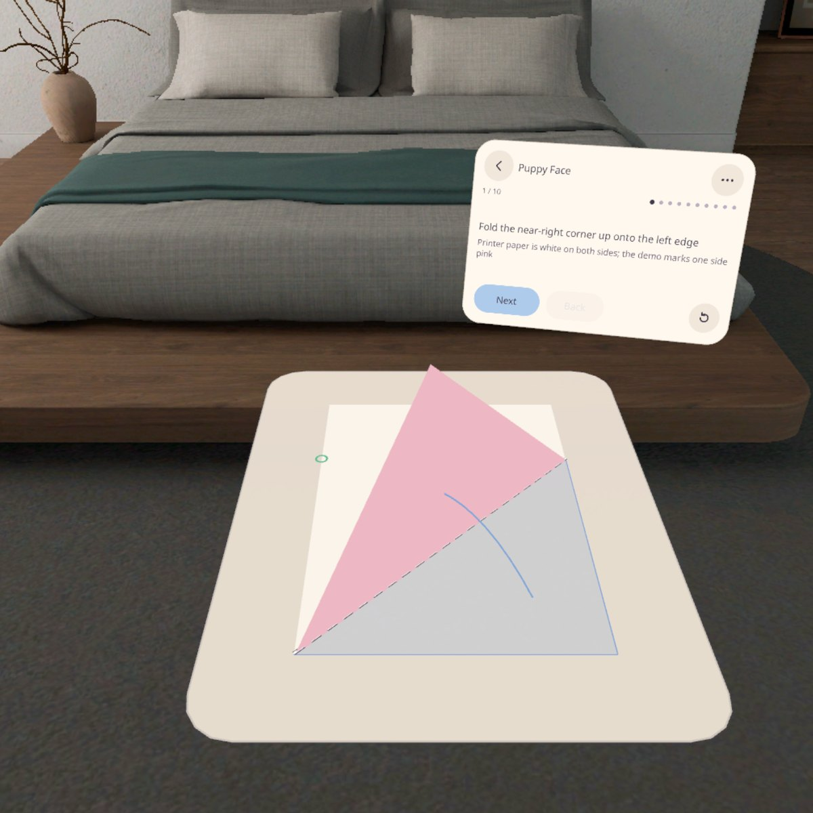
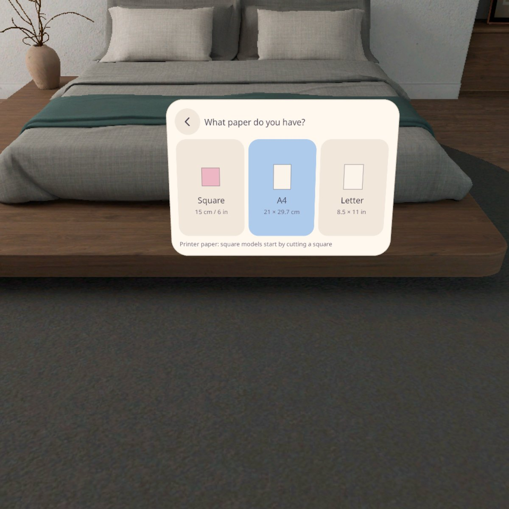
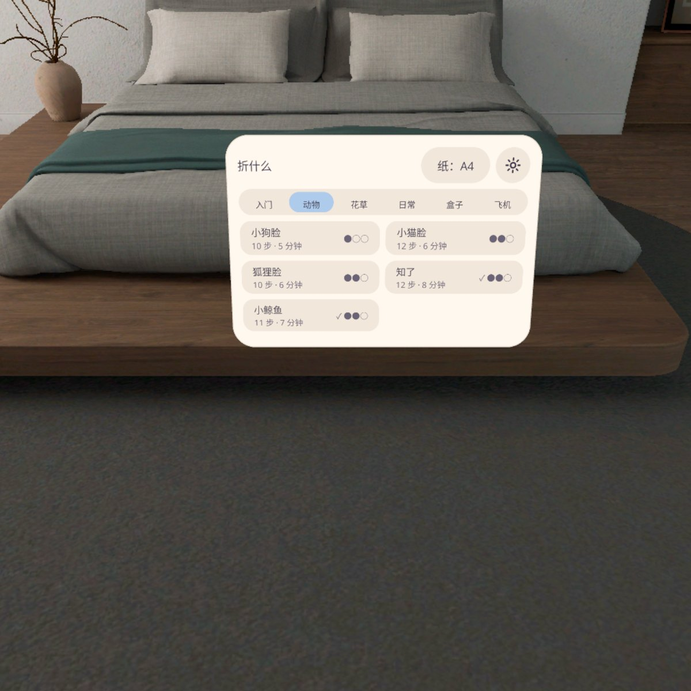
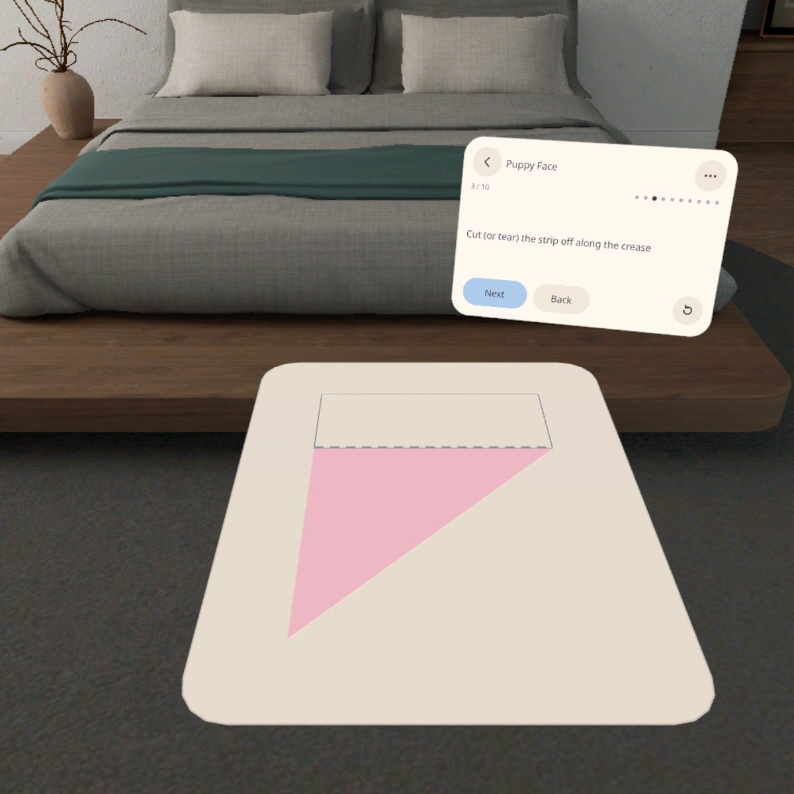
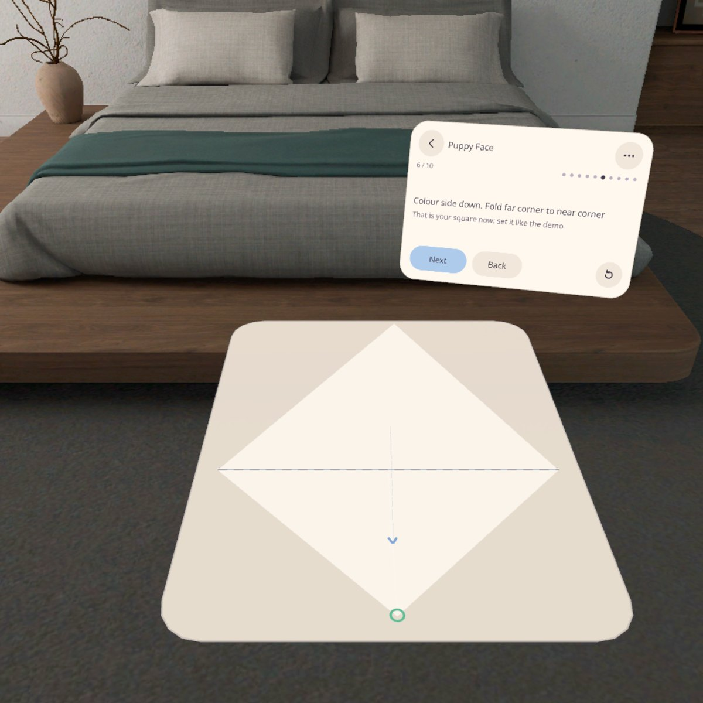
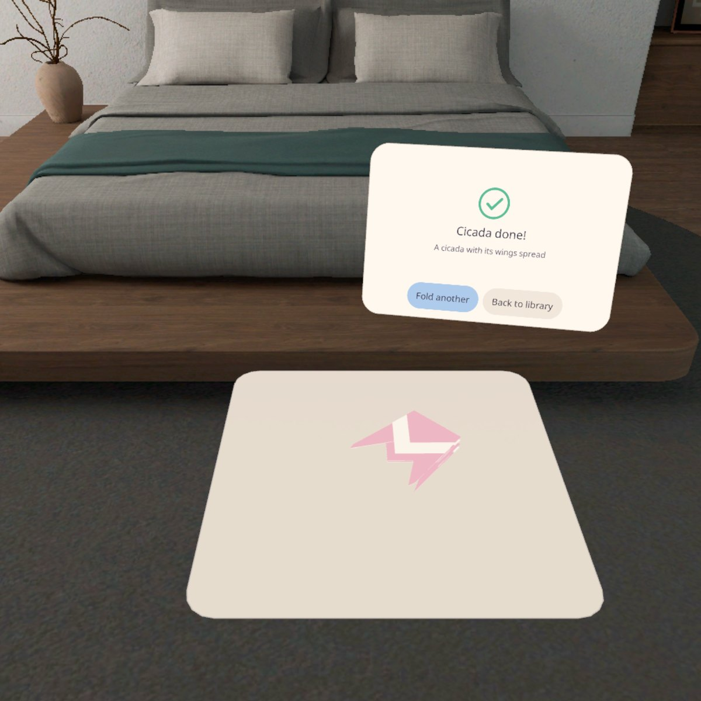
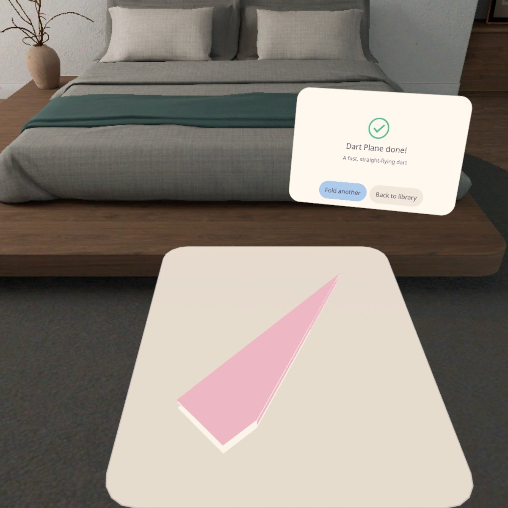
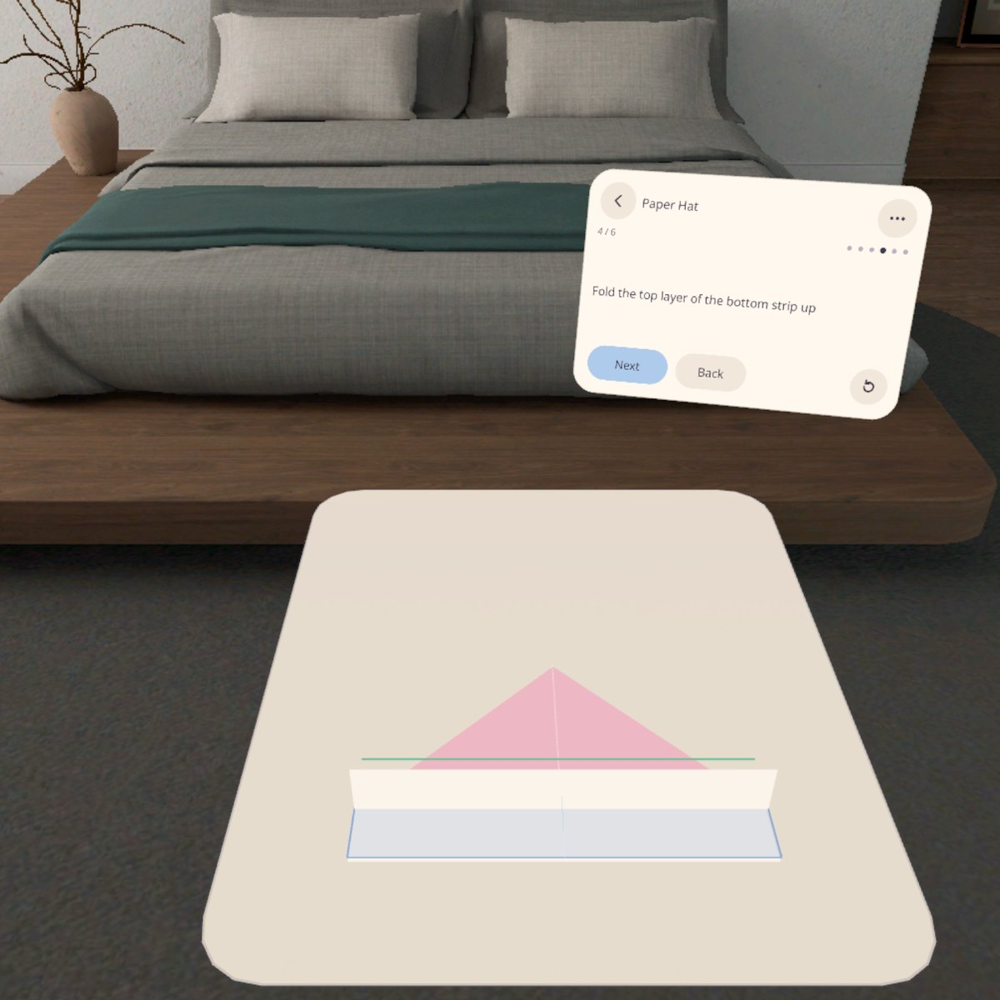

<p align="center"></p>

# Fold Guide | 折纸向导

**桌上放一张和你的纸一样大的演示纸，它把每一步折给你看，你拿自己的纸跟着折一步。方形折纸、A4、Letter 打印纸都能用。**

**A life-size demo sheet lies on your desk next to your own paper. It folds each step for you, and you fold your real paper along with it. Works with origami squares and with A4 / Letter printer paper.**

PICO OS 6 · PICO Spatial SDK 6.1.9 · Kotlin / SpatialUI · package `io.embodit.foldguide` · v0.1.1

> **模拟器 QA 通过；用户已在 PICO 头显上试用并同意发布（Simulator-QA passed; tried on a PICO headset by the owner and approved for release）。**



> 截图来自原生模拟器（PICO Emulator 6.1），由调试广播驱动跳转到各状态；**非真实手势录像**。
> Screenshots were taken on the native PICO emulator, driven by debug broadcasts that jump to each state; **not a recording of real hand gestures.**

---

## 中文

### 这是什么

坐到桌前，选好手上的纸（15 cm 方形折纸、A4 或 Letter）。看着桌面捏一下，你的纸旁边就放下一张同样大小的演示纸，步骤面板立在旁边。每一步，演示纸上先画出折线（谷折虚线、山折点划线）、把要动的那一块染色、画一条弧形箭头指到落点，然后自己折 3 遍，停在折好的样子；你照着折自己的纸。可以低头看、捏住演示纸转过来；撑杯口、立盒墙这种立体步，演示纸会抬起来做。

**v0.1.1（打磨版）**
- **18 个作品，6 个分类**，难度 1–3 点：入门（基础折法、打印纸变正方形）· 动物（小狗脸、小猫脸、狐狸脸、知了、小鲸鱼）· 花草（郁金香、四瓣花）· 日常（爱心、小信封、小纸帽）· 盒子（纸杯、方盒、卡片钱包）· 飞机（小飞镖、尖头纸飞机、滑翔机）。
- **打印纸**：纸帽、钱包、尖头纸飞机、滑翔机直接用 A4 / Letter 折；方形作品用打印纸时，前面自动多 4–5 步，教你把它折出、剪出一张正方形（再转成菱形）。演示纸按你的纸的真实大小显示。
- **低饱和配色**：奶油色卡片面板、雾粉演示纸、雾蓝箭头、薄荷落点。
- **不用走动、不卡扫描**：找不到桌子约 5 秒，演示纸就放到你面前的虚拟桌面上；任何时候都可以点「放在面前」。

翻步可以点「下一步」，也可以打开「注视翻页」。没折完的作品下次打开会问「接着折吗」。中英双语，全部本机保存，不联网。

### 安装与启动

```bash
adb install -r FoldGuide-v0.1.1.apk
pico-cli app launch io.embodit.foldguide
```

APK 在 [Releases](https://github.com/kejing-dev/FoldGuide/releases) 页面下载（仓库不含 APK）。需要 PICO OS 6 头显或 PICO Emulator 6.1。APK 约 34 MB。从 v0.1.0 升级时如果签名不同，先 `adb uninstall io.embodit.foldguide`。

### 截图

| | |
|---|---|
|  |  |
| 先选纸：正方形 / A4 / Letter | 图库：6 个分类，每个作品带步数、时长、难度 |
|  |  |
| A4 变正方形：沿折痕剪掉纸条 | 转成菱形，开始折小狗脸 |
|  |  |
| 知了 | 爱心 |
|  |  |
| 尖头纸飞机（A4） | 小纸帽（Letter） |

### 容器与结构

- **容器**：Full Space · `STAGE_MIXED`（透视）。演示纸要贴在真实桌面上、和你的纸一样大，用到平面检测；找不到桌面时放到虚拟桌面上。
- **折纸数据**：在 `tools/foldlib/`（Python）里写，每一步都检查（落点误差 ≤ 0.5 mm、范围、文案长度）并逐步出图，再生成 `FoldLibraryData.kt`；Kotlin 的 `FoldEngine` 用同一套规则，单元测试覆盖每个作品在每种纸上的每一步。
- 结构、调试广播、截图清单见 [AGENTS.md](AGENTS.md)。

### 还没验到

真实桌面上（非虚拟桌面）的遮挡、真眼睛的注视翻页手感、手里拿纸时会不会误捏、新作品在真纸上的折法细节。

---

## English

### What it is

Sit at a desk and pick the paper you have (a 15 cm origami square, A4 or Letter). Look at the desk and pinch: a demo sheet of the same size lands next to your paper, with the step panel beside it. For every step the demo sheet draws the fold line (valley dashes, mountain dash-dots), tints the flap that moves, arches an arrow to where it lands, then folds itself three times and stops folded; you fold your own paper the same way. 3D steps (opening the cup, raising the box walls) lift off the desk.

**v0.1.1 (polish)**
- **18 models on six shelves**, difficulty 1–3: Basics (Folding Basics, Square from Printer Paper) · Animals (Puppy, Kitten, Fox, Cicada, Little Whale) · Flowers (Tulip, Four-Petal Flower) · Everyday (Heart, Little Envelope, Paper Hat) · Boxes (Paper Cup, Masu Box, Card Wallet) · Planes (Paper Arrow, Dart Plane, Glider).
- **Printer paper**: the hat, wallet, dart and glider fold straight from A4 / Letter; square models on printer paper start with 4–5 extra steps that turn the sheet into a square (and then a diamond). The demo sheet is drawn at your paper's real size.
- **Low-saturation palette**: cream card panels, mist-pink demo sheet, mist-blue arrows, mint landings.
- **No walking, no scanning stall**: with no desk found in about 5 s, the demo sheet goes on a virtual desk in front of you; "Put it in front" works at any time.

Turn steps with Next or with gaze paging. An unfinished model offers "Continue?" next time. Chinese and English; everything stays on the device, no network.

### Install and launch

```bash
adb install -r FoldGuide-v0.1.1.apk
pico-cli app launch io.embodit.foldguide
```

Download the APK from the [Releases](https://github.com/kejing-dev/FoldGuide/releases) page (the repository does not ship an APK). Needs a PICO OS 6 headset or PICO Emulator 6.1; about 34 MB. If an older build was signed with a different key, run `adb uninstall io.embodit.foldguide` first.

### Container and structure

- **Container**: Full Space, `STAGE_MIXED` (passthrough), with desk plane detection and a virtual desk fallback.
- **Fold data** is authored in `tools/foldlib/` (Python: checks every step — landings within 0.5 mm, bounds, copy length — and renders each step), then generated into `FoldLibraryData.kt`. The Kotlin `FoldEngine` follows the same rules; unit tests cover every model on every paper.
- Structure, debug broadcasts and the screenshot list: [AGENTS.md](AGENTS.md).

### Screenshots

See the table above: paper choice, the library, cutting a square from A4, turning it into a diamond, cicada, heart, dart (A4), paper hat (Letter).

### Not yet verified

Occlusion on a real (non-virtual) desk, gaze paging with real eyes, accidental pinches while holding paper, and the finer folding details of the new models on real paper.

---

## License

Source code © 2026 Embodit. All rights reserved (private repository). Bundled fonts Noto Sans / Noto Sans SC (subset) are under the SIL Open Font License, see `third_party/`.
