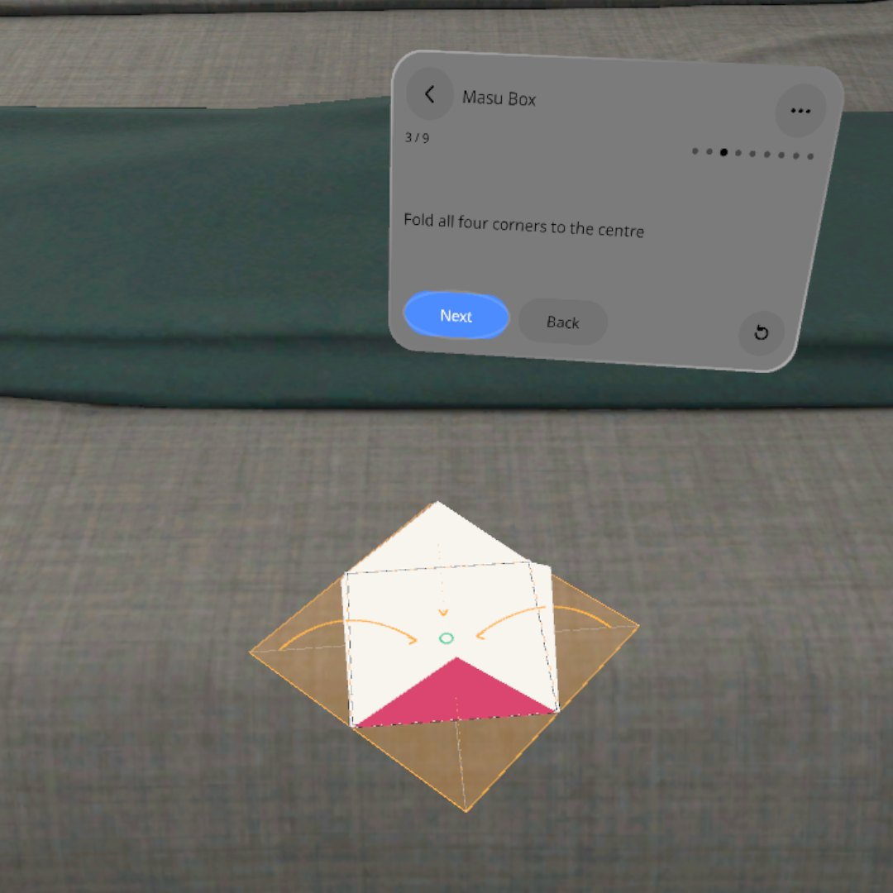
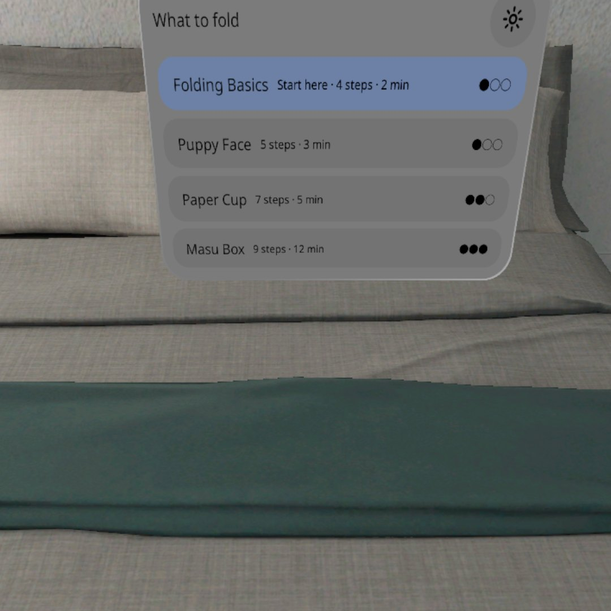
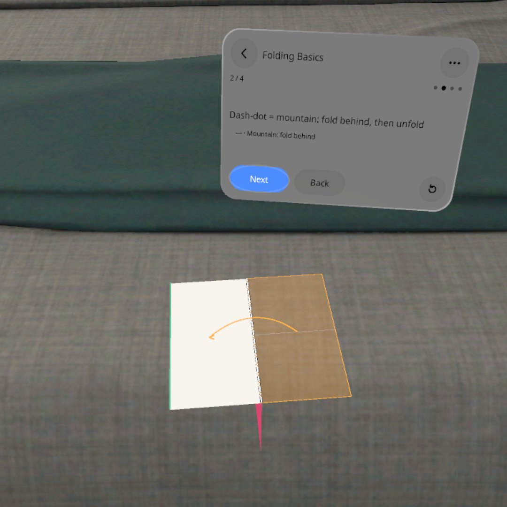
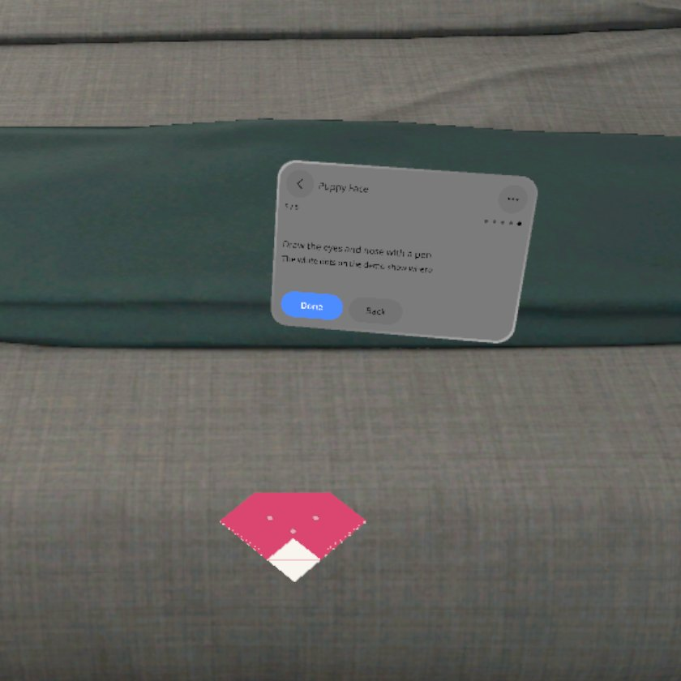
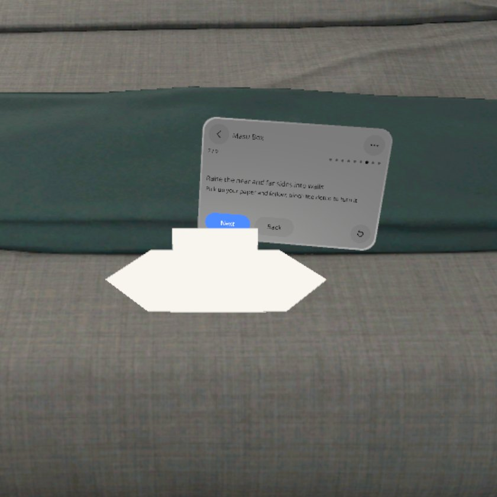
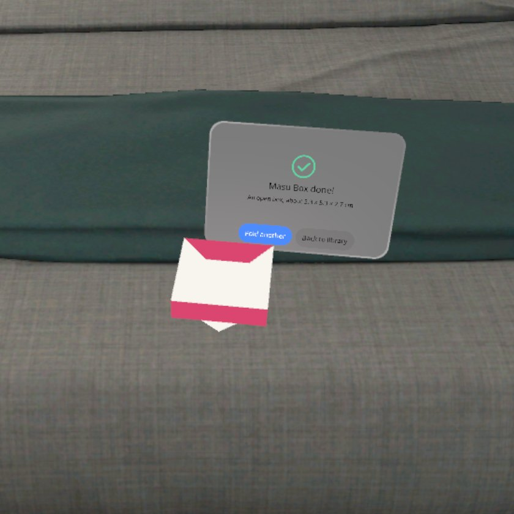
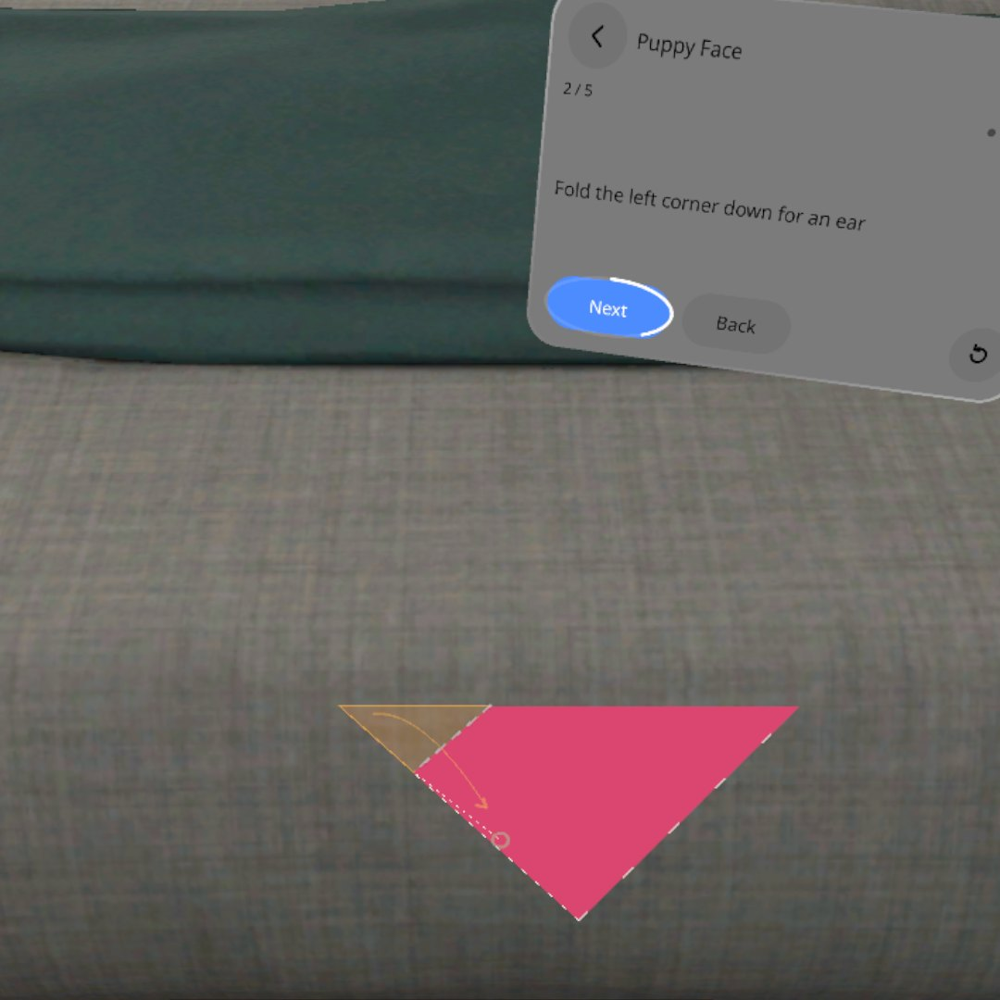
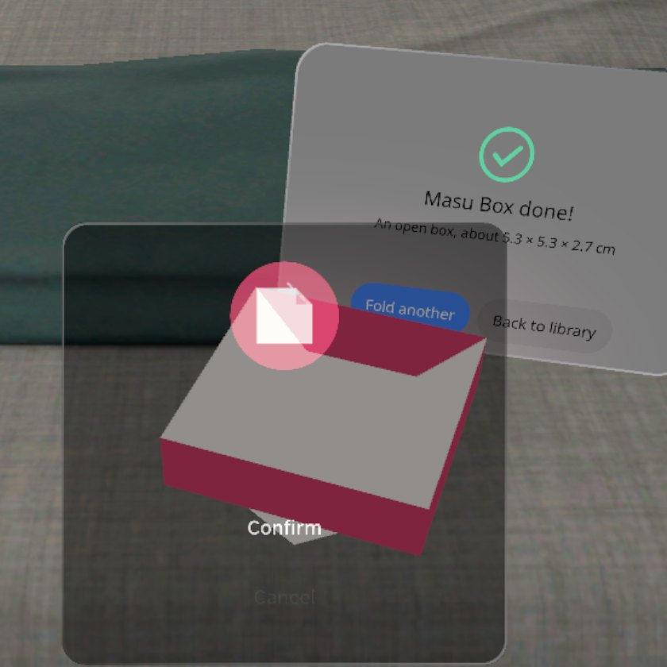

<p align="center"></p>

# Fold Guide | 折纸向导

**桌上放一张和你的纸一样大的演示纸，它把每一步折给你看，你拿自己的纸跟着折一步；不识别你的纸，也不用对齐。**

**A life-size demo sheet lies on your desk next to your own paper. It folds each step for you, and you fold your real paper along with it — no paper detection, no lining up.**

PICO OS 6 · PICO Spatial SDK 6.1.9 · Kotlin / SpatialUI · package `io.embodit.foldguide` · v0.1.0 (pre-release / 预发布)

> **模拟器 QA 通过，真机未验证（Simulator-QA passed; not yet verified on a real headset）。**



> 截图和演示视频来自原生模拟器（PICO Emulator 6.1），由调试广播驱动跳转到各设计状态；**非真实手势录像**。
> Screenshots and the demo video were taken on the native PICO emulator, driven by debug broadcasts that jump to each design state; **not a recording of real hand gestures.**

---

## 中文

### 这是什么

拿一张 15 cm 的方形折纸坐到桌前。看着桌面捏一下，你的纸旁边就放下一张同样大小的演示纸，步骤面板立在它后面。每一步，演示纸上先画出折线（谷折虚线、山折点划线）、把要动的那一块染色、画一条弧形箭头指到落点，然后自己折 3 遍，停在折好的样子；你照着折自己的纸。可以低头、侧身绕着看，也可以捏住演示纸转过来；撑杯口、立盒墙这种立体步，演示纸会原地抬起来做。

四个作品由易到难：基础折法（先学看图）、小狗脸（5 步）、纸杯（7 步）、方盒（9 步）。翻步可以点「下一步」，也可以打开「注视翻页」：演示折完一遍后看着「下一步」1 秒就翻，手里拿着纸也能翻。没折完的作品下次打开会问「接着折吗」。中英双语，全部本机保存，不联网。

### 安装与启动

```bash
adb install -r FoldGuide-v0.1.0.apk
pico-cli app launch io.embodit.foldguide
```

APK 在 [Releases](https://github.com/kejing-dev/FoldGuide/releases) 页面下载（仓库不含 APK）。需要 PICO OS 6 头显或 PICO Emulator 6.1；用到桌面平面检测。APK 约 34 MB。

### 容器与骨架

- **容器**：只有 Full Space · `STAGE_MIXED`（透视），没有 Shared Space 版本。演示纸要贴在你真实的桌面上、和你的纸一样大，依赖平面检测，只在 Full Space 可用。
- **骨架 D**（同空间尺 Spatial Ruler / 火情预案 Fire Plan）：平面检测找桌面、射线-平面求交放纸、懒跟随面板、面板池、每帧朝向 System。折纸几何（全折、翻面、压痕、动画分块）在纯 Kotlin 的 `FoldEngine`，有单元测试对照落点。
- **状态**：设计包 14 个状态（S00–S18），全部可由调试广播直接跳转并截图，结构见 [AGENTS.md](AGENTS.md)。

### 截图

| | |
|---|---|
|  |  |
| 作品库 — 四个作品，第一次先学「基础折法」 | 山折 — 点划线，折到一半整块翻到背后 |
|  |  |
| 小狗脸 — 最后一步画三个点 | 立体步 — 演示纸抬到桌上 15 cm 立盒墙 |
|  |  |
| 折好了 — 成品慢转，「再折一个」 | 注视翻页 — 看着「下一步」，外圈 1 秒走满就翻 |

启动器图标：



### 已知问题（QA 第 2 轮，不影响使用）

- 坐着看时，纸杯第 7 步、方盒第 7–9 步和「折好了」抬起的立体纸会挡住面板的「下一步」「再折一个」；捏那个位置仍然能按到，只是看不见按钮。
- 用调试命令直接跳到「清空记录」确认框时框画成黑色；从设置里正常点进来是好的，用户碰不到。
- 演示纸会画在系统「回到主页」框前面，框里的按钮还能按。

还没在头显上验过：真眼睛看着「下一步」翻页的手感（现在用的是头的朝向）、手柄摇杆转演示纸、手里拿着纸时会不会误捏误翻、透视里折线清不清楚、真实空间权限流程。

---

## English

### What it is

Sit at a desk with a 15 cm square of origami paper. Look at the desk and pinch: a demo sheet of the same size lands next to your paper, with the step panel standing behind it. For every step the demo sheet draws the fold line (valley dashes, mountain dash-dots), tints the flap that moves, arches an arrow to where it lands, then folds itself three times and stops folded; you fold your own paper the same way. Lean in or walk around to look, or pinch the sheet and turn it; for 3D steps (opening the cup, raising the box walls) the sheet lifts up off the desk.

Four models, easiest first: Folding Basics (reading the symbols), Puppy Face (5 steps), Paper Cup (7), Masu Box (9). Turn steps with Next, or switch on gaze paging: once the demo has played, look at Next for one second — it works with paper in both hands. An unfinished model offers "Continue?" next time. Chinese and English; everything is stored on the device, no network.

### Install and launch

```bash
adb install -r FoldGuide-v0.1.0.apk
pico-cli app launch io.embodit.foldguide
```

Download the APK from the [Releases](https://github.com/kejing-dev/FoldGuide/releases) page (the repository itself does not ship an APK). Needs a PICO OS 6 headset or PICO Emulator 6.1; uses table plane detection. The APK is about 34 MB.

### Container and skeleton

- **Container**: Full Space only, `STAGE_MIXED` (passthrough); no Shared Space version. The demo sheet must lie on your real desk at real size, which needs plane detection — Full Space only.
- **Skeleton D** (same as Spatial Ruler / Fire Plan): plane detection for the desk, ray-plane hit to place the sheet, lazy-follow panel, panel pool, per-frame billboarding system. Fold geometry (fold-all, flip, crease, animation parts) lives in a pure Kotlin `FoldEngine` with unit tests on landing points.
- **States**: 14 designed states (S00–S18), each reachable by a debug broadcast and captured; see [AGENTS.md](AGENTS.md).

### Screenshots

See the table above: model library, mountain fold, puppy face dots, 3D step, finished box, gaze paging ring.

### Known issues (QA round 2, none blocking)

- Seated, the lifted 3D sheet (Paper Cup step 7, Masu Box steps 7–9 and "Done") hides the panel's Next / Fold another buttons; pinching there still presses them, you just cannot see them.
- Jumping straight to the "Clear history" confirmation by debug command draws it black; reached normally from Settings it is fine.
- The demo sheet draws in front of the system "Back to Home" dialog; its buttons still work.

Not yet verified on a headset: gaze paging with real eyes (it currently uses head direction), thumbstick turning of the demo sheet, accidental pinches or page turns while holding paper, fold-line legibility in passthrough, and the real spatial permission flow.

---

## License

Source code © 2026 Embodit. All rights reserved (private repository). Bundled fonts Noto Sans / Noto Sans SC (subset) are under the SIL Open Font License, see `third_party/`.
